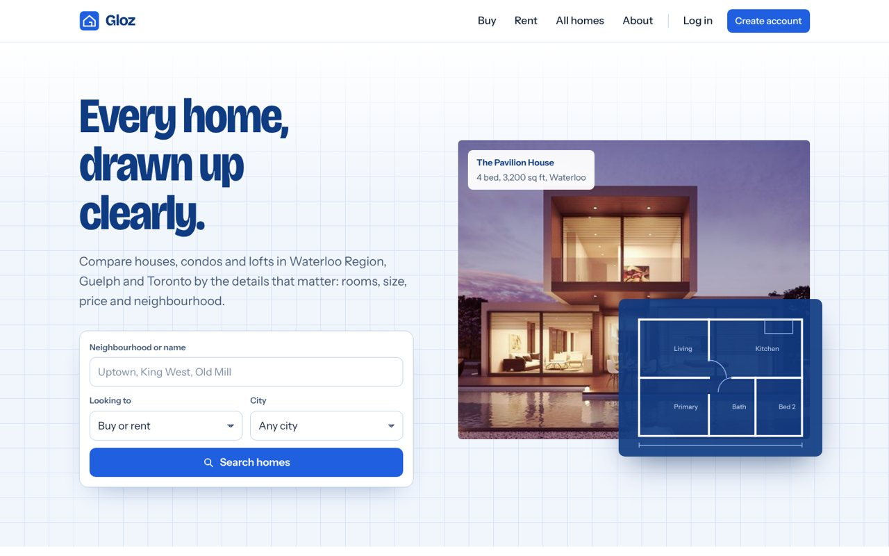
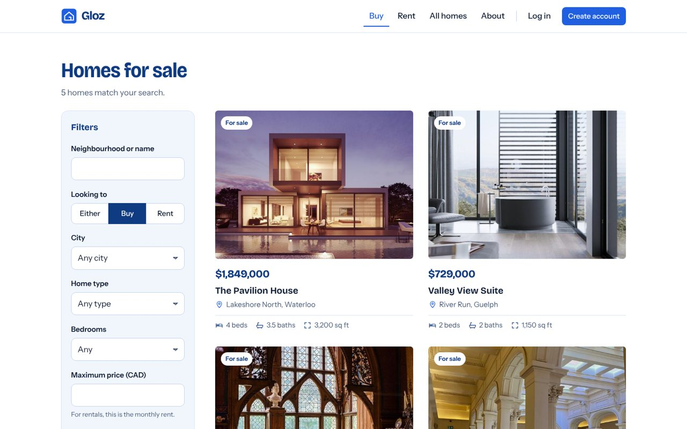
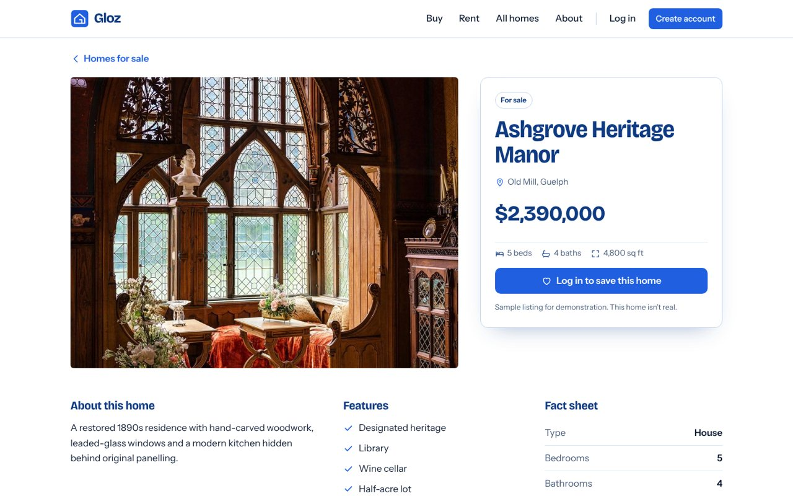
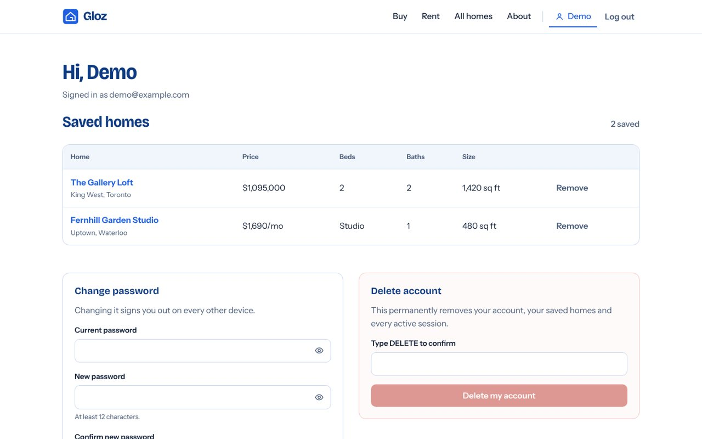
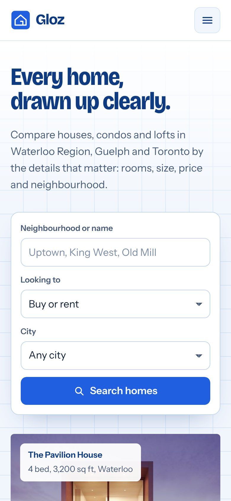

# Gloz

**A secure property listings web app: search homes, create an account and keep a shortlist.**

Gloz lets people browse houses, condos and lofts for sale or rent in Waterloo, Kitchener, Guelph and Toronto, filter them by the details that matter, and save the ones they like to compare later. It is built with Flask and plain HTML, CSS and JavaScript, with security designed in from the start: Argon2id password hashing, server-side sessions, CSRF protection, rate limiting and a strict Content Security Policy.

> 🏠 Portfolio project. Every listing is fictional sample content; no property is actually for sale or rent.



## Features

- 🔎 **Search and filters**: by neighbourhood, buy or rent, city, home type, bedrooms and maximum price, with sorting. Filtering happens on the server, so every search has a shareable URL.
- 🏡 **Listing pages** with photos, key specs, features and a fact sheet.
- 👤 **Accounts**: sign up, log in, log out, change password and delete your account (and all its data) at any time.
- ❤️ **Saved homes**: save listings with one click and compare them side by side in a table.
- 📱 **Responsive and accessible**: works from 360 px phones to wide screens, keyboard friendly, visible focus, labelled fields, reduced-motion support (WCAG 2.1 AA as the target).
- 🔐 **Security first**: see [Security](#security) below.

| Search results | Listing detail |
| --- | --- |
|  |  |

| Account and saved homes | Mobile |
| --- | --- |
|  |  |

## Tech stack

| Layer | Technologies |
| --- | --- |
| Backend | Python 3.13, Flask 3, Jinja2 |
| Database | SQLite (parameterized queries only) |
| Auth | Argon2id (`argon2-cffi`), hashed server-side session tokens, double-submit CSRF tokens |
| Frontend | Semantic HTML, custom CSS (no framework), vanilla JavaScript, self-hosted variable fonts |
| Testing & QA | pytest (64 tests), Bandit, pip-audit, Semgrep, Gitleaks, Playwright (manual browser checks) |
| CI | GitHub Actions with pinned action SHAs and read-only permissions, Dependabot |
| Deploy | Gunicorn behind Caddy (automatic HTTPS) |

## Project structure

```
gloz/
├── app/                     Flask application package
│   ├── __init__.py          App factory: config, blueprints, error pages
│   ├── config.py            Settings from environment variables (fail-closed)
│   ├── db.py                SQLite connection and schema
│   ├── security.py          Security headers, CSRF, rate limiting, security log
│   ├── validation.py        Strict server-side form validation
│   ├── auth.py              Sign-up, log-in, sessions, lockout, account, saved homes
│   ├── listings.py          Sample listings data and the search/filter logic
│   ├── views.py             Public pages: home, listings, detail, about, legal
│   ├── templates/           Jinja2 templates (base layout, pages, partials, auth, legal)
│   └── static/
│       ├── css/gloz.css     Design system and all styles
│       ├── js/gloz.js       Small progressive enhancements (menu, show password)
│       ├── fonts/           Bricolage Grotesque and Instrument Sans (OFL licensed)
│       └── img/             Optimized listing photos (800 px and 1600 px) and favicon
├── tests/                   pytest suite: config, routes, headers, listings, auth, abuse cases
├── docs/                    Architecture, security model, deployment guide, credits, screenshots
├── deploy/Caddyfile         Example HTTPS reverse-proxy configuration
├── scripts/                 scan_exposed_files.sh: fails if secrets or data files are tracked
├── .github/                 CI security pipeline and Dependabot
├── run.py                   Local development server
├── wsgi.py                  Production entry point for Gunicorn
├── requirements.txt         Direct dependencies
├── requirements-lock.txt    Exact pinned versions
├── requirements-dev.txt     Test and audit tools
├── .env.example             Template for local configuration (no real values)
└── SECURITY_REPORT.md       Latest audit results and findings
```

A deeper walkthrough of how a request flows through these modules is in [docs/ARCHITECTURE.md](docs/ARCHITECTURE.md).

## Run it locally

**Requirements:** Python 3.12 or newer.

1. **Clone and enter the project**
   ```bash
   git clone https://github.com/Hsoja/Gloz.git
   cd Gloz
   ```
2. **Create a virtual environment and install dependencies**
   ```bash
   python -m venv .venv
   source .venv/bin/activate        # Windows: .venv\Scripts\activate
   pip install -r requirements-dev.txt
   ```
3. **Create your `.env`** from the template and generate two different secrets:
   ```bash
   cp .env.example .env             # Windows: copy .env.example .env
   python -c "import secrets; print(secrets.token_urlsafe(48))"   # paste as SECRET_KEY
   python -c "import secrets; print(secrets.token_urlsafe(24))"   # paste as IP_HASH_SALT
   ```
   The app refuses to start if these are missing, too short or identical.
4. **Start the server**
   ```bash
   python run.py                    # http://127.0.0.1:5000
   ```
   The database (`instance/gloz.sqlite3`) is created automatically on first run. There are no default accounts: create one from the sign-up page.

### Configuration

| Variable | Required | Description |
| --- | --- | --- |
| `GLOZ_ENV` | No | `development`, `test` or `production` (default `production`, the safest) |
| `SECRET_KEY` | Yes | At least 32 random characters. Signs the one-time flash-message cookie |
| `IP_HASH_SALT` | Yes | At least 16 random characters, different from `SECRET_KEY`. Pseudonymizes IPs in logs |
| `DATABASE_PATH` | No | SQLite file location (default `instance/gloz.sqlite3`) |
| `LOG_DIR` | No | Security log folder (default `logs/`) |
| `SESSION_HOURS` | No | Session lifetime in hours (default 12) |
| `TRUSTED_PROXIES` | No | Comma-separated proxy IPs allowed to set `X-Forwarded-For` |

## Tests and security checks

```bash
python -m pytest                                         # 64 tests
pip-audit -r requirements-lock.txt                       # known vulnerabilities in dependencies
bandit -q -r app wsgi.py run.py --severity-level medium  # Python security linter
bash scripts/scan_exposed_files.sh                       # no secrets or data files tracked by Git
gitleaks git . --log-opts=--all --redact=100             # secrets in the full Git history
semgrep scan --config p/python --config p/flask --error  # static analysis
```

The same checks run on every push and pull request in [.github/workflows/security.yml](.github/workflows/security.yml).

## Security

Gloz handles accounts and passwords, so it follows a security-by-default approach:

- **Passwords** are hashed with Argon2id and rehashed automatically when parameters change. Minimum 12 characters.
- **Sessions** use random tokens stored only as SHA-256 hashes, in cookies that are `HttpOnly`, `Secure` and `SameSite=Strict` (with the `__Host-` prefix in production). Changing your password signs out every other device.
- **CSRF**: every form that changes data carries a double-submit token, plus an origin check.
- **Brute force**: per-route rate limits and a progressive lock (1 min, 2 min, 4 min… up to 1 hour) per account and per IP. Wrong password and unknown email return the same message.
- **Input**: strict server-side validation with length limits and allow-listed fields; request bodies are capped at 16 KB; all SQL is parameterized; Jinja2 escapes all output.
- **Headers**: strict CSP (`script-src 'self'`, no inline code), `X-Frame-Options: DENY`, `nosniff`, Referrer and Permissions policies, HSTS in production.
- **Privacy**: no analytics or third-party scripts, fonts are self-hosted, and the security log stores only salted hashes of IPs, never emails or passwords.
- **Fail-closed configuration**: no default credentials, debug mode always off, and the app won't start with weak secrets.

The threat model and controls are documented in [docs/SECURITY.md](docs/SECURITY.md), and the latest audit in [SECURITY_REPORT.md](SECURITY_REPORT.md).

## Documentation

- [Architecture](docs/ARCHITECTURE.md): modules, request flow, data model and design decisions
- [Security model](docs/SECURITY.md): threats, controls, key rotation and incident response
- [Deployment](docs/DEPLOYMENT.md): running in production with Gunicorn and Caddy
- [Credits](docs/CREDITS.md): photos and fonts
- [Security report](SECURITY_REPORT.md): latest audit results

## Roadmap

- [x] Restructure into a Flask app package with blueprints
- [x] Real sign-up, log-in and saved homes
- [x] Security hardening and automated security pipeline
- [x] New responsive design
- [ ] Email verification and password reset
- [ ] Listing management for agents (roles and permissions)
- [ ] Map view of results
- [ ] PostgreSQL and migrations for multi-instance deployments

## What I learned

Structuring a Flask app with an application factory and blueprints, designing authentication without shortcuts (hashing, sessions, CSRF, lockout), writing tests that try to break the app rather than just confirm it works, and building a responsive design system without a CSS framework.

## Author

**Katherine Mauricio Gonzalez**, Software Engineering student at Conestoga College, Waterloo, ON.
